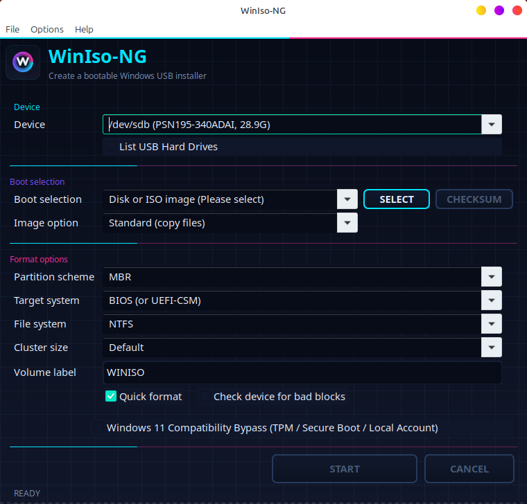

<div align="center">
<h1>WinIso-NG</h1>

</div>



_Create bootable Windows (and Linux) USB installers from the Linux desktop — with a Rufus-style form and a dark neon interface._

WinIso-NG is a fork of [WoeUSB-ng](https://github.com/WoeUSB/WoeUSB-ng). It writes an ISO/IMG image to a USB storage device and makes it bootable, with the same workflow and options you know from Rufus: pick the device, pick the image, choose MBR/GPT, filesystem and options, then press **START**.

## Features

**Drive properties**

* Device selector listing removable USB drives, plus **List USB Hard Drives** to reveal USB disks/SSDs
* **Host disk protection**: any physical disk backing `/`, `/boot`, `/boot/efi`, `/home` or swap is always hidden — even with *List USB Hard Drives* enabled — so the running system can never be wiped by accident
* **Target confirmation dialog** before writing, showing the device model, size and `/dev/sdX` path
* Boot selection: **Disk or ISO image**, or **Non bootable** (format the drive as plain storage)
* **Image option**: *Standard (copy files)* or *DD image mode (raw write)*
* **SELECT** to choose the image and **CHECKSUM** for MD5 / SHA-1 / SHA-256 / SHA-512

**Format options**

* Partition scheme: **MBR** or **GPT** (picking GPT sets *UEFI (non CSM)* automatically, like Rufus)
* Target system: **BIOS (or UEFI-CSM)** or **UEFI (non CSM)**
* File systems: **FAT32**, **NTFS**, **exFAT**, **UDF** (only the ones whose tools are installed are offered)
* **Cluster size** selection, **Volume label**
* **Quick format** and **Check device for bad blocks** (destructive, one pass)
* **Windows 11 Compatibility Bypass (TPM / Secure Boot / Local Account)**

**During the job**

* Inline status line, neon progress bar, **Cancel**
* Live log window (Options → Show log)
* UEFI:NTFS support partition, Windows 7 UEFI workaround, legacy GRUB bootloader for BIOS targets

## Windows 11 compatibility bypass

Enable **Windows 11 Compatibility Bypass (TPM / Secure Boot / Local Account)** in the GUI, or pass `--win11-bypass` on the command line. WinIso-NG then writes an `autounattend.xml` to the root of the installation partition, containing:

* `HKLM\SYSTEM\Setup\LabConfig` → `BypassTPMCheck=1`, `BypassSecureBootCheck=1`, `BypassRAMCheck=1` (plus `BypassCPUCheck` and `BypassStorageCheck`)
* `HKLM\SOFTWARE\Microsoft\Windows\CurrentVersion\OOBE` → `BypassNRO=1`, so setup can be finished with a local account and no network

Nothing else in the image is modified, and the bypass is only written when the option is selected.

## FAT32 and large `install.wim` files

A FAT32 filesystem cannot store a single file larger than 4 GiB, and modern Windows images ship an `install.wim` well above that. Instead of silently switching the target to NTFS, WinIso-NG now:

1. detects that `install.wim` is oversized while the source image is still mounted;
2. splits it into `install.swm` parts with `wimlib-imagex split` (`wimsplit`), 3800 MiB each, directly into `sources/` on the target;
3. copies everything else to the FAT32 target and leaves the original `install.wim` out.

The result is a strictly FAT32 device (the most compatible option for old firmware) that can still install a current Windows build. Splitting needs the `wimtools` package, which the `.deb` installs automatically. Images that ship an oversized `install.esd` cannot be split; in that case choose NTFS, exFAT or UDF.

## Install

### From the Releases page (recommended)

Every version is published as a ready-to-install `.deb`:

1. open the [**Releases**](../../releases) page;
2. download `winiso-ng_<version>_all.deb` from the newest release;
3. install it:

```shell
sudo apt install ./winiso-ng_0.3.0_all.deb
```

The package pulls in its dependencies (wxPython, `wimtools`, `parted`, `dosfstools`, `ntfs-3g`, …) and installs the `winiso` and `winisogui` commands, the menu entry, the polkit policy and the bundled Orbitron/Rajdhani fonts.

### Build the .deb yourself

```shell
git clone https://github.com/SysArchX/WinIso-NG.git
cd WinIso-NG
./packaging/build_deb.sh          # writes dist/winiso-ng_<version>_all.deb
sudo apt install ./dist/winiso-ng_0.3.0_all.deb
```

### From source

```shell
sudo apt install git p7zip-full python3-pip python3-wxgtk4.0 grub2-common grub-pc-bin parted dosfstools ntfs-3g exfatprogs udftools wimtools
sudo pip3 install .               # PEP 517 build from pyproject.toml
```

The project uses a `src/` layout with a single `pyproject.toml` (PEP 517/518, Python 3.12+). Entry points: `winiso` (CLI) and `winisogui` (GUI).

### Arch

```shell
sudo pacman -S --needed p7zip python-pip python-wxpython parted dosfstools ntfs-3g exfatprogs udftools wimtools
git clone https://github.com/SysArchX/WinIso-NG.git && cd WinIso-NG && sudo pip3 install .
```

## Usage

```shell
sudo winisogui                                   # graphical interface
sudo winiso --device image.iso /dev/sdX          # copy mode + legacy GRUB
sudo winiso --device image.iso /dev/sdX --image-mode DD --target-filesystem NTFS
sudo winiso --device image.iso /dev/sdX --partition-scheme GPT --target-system UEFI
sudo winiso --device image.iso /dev/sdX --target-filesystem FAT --win11-bypass
sudo winiso --device image.iso /dev/sdX --bad-blocks --cluster-size 4096
```

Run `winiso --help` for the complete option list.

## Rufus features that are not implemented

These Rufus options have no portable Linux equivalent and are deliberately absent:

* Windows To Go and Windows VHD
* Rufus MBR, Syslinux/GRUB4DOS/ReactOS bootloader installation
* Persistence partition for Ubuntu/Debian live images
* Built-in ISO download, update check and USB → VHD image dumping
* FreeDOS / MS-DOS boot media creation

Everything else in the form above is implemented natively in Python; no Rufus code was used.

## Tests

```shell
PYTHONPATH=src python3 -m unittest discover -s tests
```

The suite covers the `lsblk` device filter (root/swap/home disks are blocked, removable devices are accepted), the generated `autounattend.xml` and the `install.wim` splitting logic.

## Credits

* [WoeUSB-ng](https://github.com/WoeUSB/WoeUSB-ng) by WaxyMocha, Lin-Buo-Ren, slacka and contributors — the engine this fork started from
* [WoeUSB](https://github.com/slacka/WoeUSB) by slacka et al.
* [WinUSB](https://github.com/congelli) by Colin GILLE / congelli501
* Interface layout inspired by [Rufus](https://rufus.ie) by Pete Batard (no code shared)
* Fonts: [Orbitron](https://github.com/theleagueof/orbitron) and [Rajdhani](https://github.com/itfoundry/rajdhani), SIL Open Font License 1.1

## License

GPLv3 or later — see [COPYING](COPYING).
